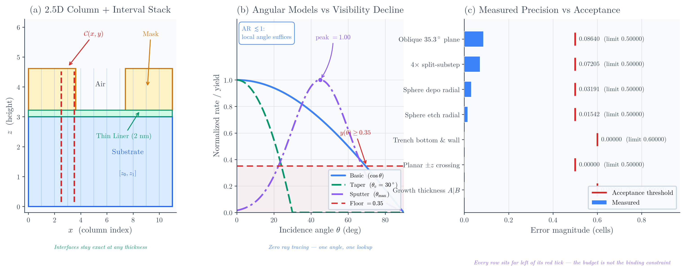
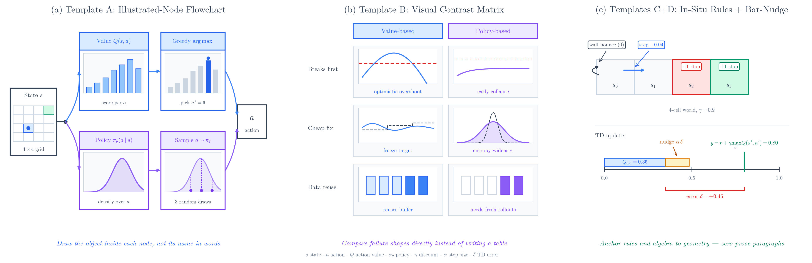

# figcraft

**Visual-first, anti-prose matplotlib skill for AI coding agents** (`pi`, OpenCode, Claude Code, Codex).

`figcraft` enforces clean scientific & textbook figure design through **high-density visual templates**, **deterministic telemetry (`audit()`)**, and a **two-auditor blind review gate** so agents stop compensating for weak drawings with walls of text or text tables.



## Why `figcraft`?

When asked to explain complex concepts visually, agents often fall back to:
- Flowchart boxes stuffed with 3 lines of prose
- Text comparison tables pretending to be diagrams
- Detached rule paragraphs and equation glossaries
- Overlaps, oval circles in non-equal axes, and low-contrast labels

`figcraft` replaces those anti-patterns with:
1. **High-Density Visual Templates** ([`assets/templates_demo.py`](assets/templates_demo.py)):
   - **Template A (`visual_node`)**: Illustrated-node flowcharts where every card embeds a real matplotlib mini-axes (bars, curves, grids, stacks).
   - **Template B (`matrix_cell`)**: Small-multiple visual contrast matrices replacing text tables.
   - **Template C (`rule_badge`)**: In-situ rule badges pinned directly onto geometry instead of prose panels.
   - **Template D (Visual Algebra)**: Bar-nudge / number-line geometry anchoring every symbol to a length or arrow.
   - **Template E (`zoom_connect`)**: Cross-panel macro → micro → trace connectors.
2. **Deterministic Automated QA (`plot_style.audit`)**: Checks text overlaps, panel spillover, canvas bounds, title baseline spread, distorted `Circle` patches, WCAG small-label contrast (`>= 4.2:1`), prose word counts (`<= 35` words/panel), and literal `\%` escapes.
3. **Two Blind PNG Auditors** ([`references/auditors.md`](references/auditors.md)):
   - **Auditor 1 (Visual-First Comprehension & Anti-Prose)**: Reviews *only the PNG + 1-line claims* using the *Cover-the-Prose 5-Second Test* and is forbidden from recommending prose additions.
   - **Auditor 2 (Geometry, Typography & Craft)**: Reviews the PNG + `audit()` telemetry against [`assets/reference_sheet.png`](assets/reference_sheet.png).



## Installation

Copy or clone `figcraft` into your agent's skills directory:

- **pi**: `~/.pi/agent/skills/figcraft`
- **OpenCode**: `~/.config/opencode/skills/figcraft` (or `.opencode/skills/figcraft`)
- **Claude Code / Codex**: `~/.claude/skills/figcraft` / `~/.codex/skills/figcraft`

### Verify Toolchain

```bash
python3 scripts/check_style.py --render
python3 assets/templates_demo.py
```

*(Optional, Linux/WSL)* To install deterministic 10 pt Latin Modern Roman + Math fonts from an existing TeX distribution:

```bash
SRC=/path/to/texmf/fonts/opentype/public bash scripts/install_fonts.sh
```

## Quick Start

```python
import pathlib, sys
sys.path.insert(0, str(pathlib.Path("path/to/figcraft/assets")))
from plot_style import *

use_style()
fig, axes = figure(2, width=14.0, height=5.4, ratios=[1.05, 1.0])
axa, axb = axes

panel(axa, "a", "Illustrated Fork: Swap the Object")
axa.set_xlim(0, 10); axa.set_ylim(0, 10); axa.axis("off")
ax_q = visual_node(axa, 1.5, 2.5, 7.0, 5.2, "Value $Q(s,a)$", r"$\arg\max_a Q$", color="blue")
ax_q.bar([1, 2, 3, 4, 5], [0.2, 0.45, 0.95, 0.6, 0.3], color=C["blue"])

# ... populate axb ...

audit(fig, "example", strict=True)
save(fig, "example.png")
```

## Repository Layout

- [`SKILL.md`](SKILL.md) — Agent skill entry point and 5-step storyboard → render → two-auditor workflow
- [`assets/plot_style.py`](assets/plot_style.py) — House rcParams, semantic palette, visual-template primitives, and `audit()`
- [`assets/plot_style_demo.py`](assets/plot_style_demo.py) / [`assets/reference_sheet.png`](assets/reference_sheet.png) — Core plot & schematic register
- [`assets/templates_demo.py`](assets/templates_demo.py) / [`assets/templates_demo.png`](assets/templates_demo.png) — Illustrated-node, contrast-matrix, and in-situ-rule templates
- [`references/auditors.md`](references/auditors.md) — Storyboard gate and Auditor 1 & 2 prompts
- [`references/grammar.md`](references/grammar.md) — Palette hexes, typography ladder, word budgets, anti-patterns
- [`references/recipes.md`](references/recipes.md) — 16 reusable panel recipes & visual templates
- [`scripts/check_style.py`](scripts/check_style.py) — Toolchain & `audit()` smoke verification
- [`scripts/install_fonts.sh`](scripts/install_fonts.sh) — Optional 10 pt Latin Modern font installer
